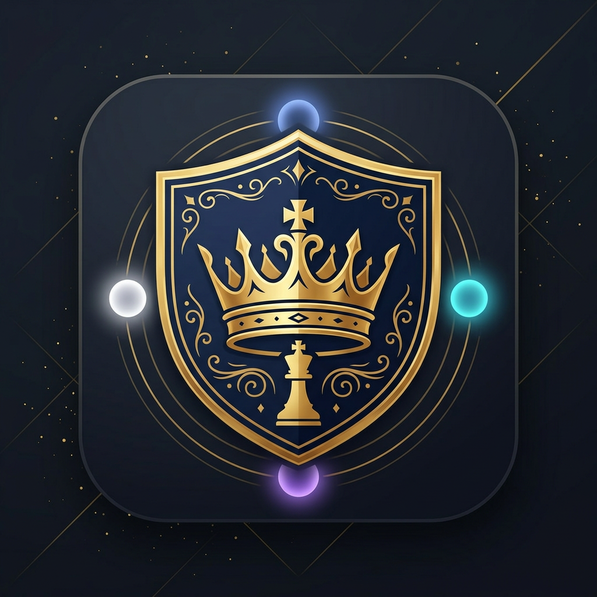

# CHESS LEGION — The Four Minds Arena

> A complete, polished, cross-platform chess application with synchronized multi-agent AI and genuine real-time online multiplayer.



**Live stack:** React 18 + Vite + chess.js + Socket.IO + Express + PWA  
**AI:** Four Minds Omega Protocol — Predictor · Calculator · Confirmer · Player  
**Platforms:** Android, iOS, Windows, macOS, Linux, Desktop & Mobile browsers (PWA)

---

## ◈ What is Chess Legion?

Not a demo board — a full chess platform:

- **Complete chess rules** — 100% legal move validation, en passant, castling, promotion, check, checkmate, stalemate, three/fivefold repetition, 50/75-move, insufficient material, FEN/PGN/SAN.
- **10 difficulty levels** from Beginner (400 Elo) to **FOUR MINDS — OMEGA** (2450 Elo) with genuine strength scaling (search depth, time, evaluation noise, blunder rate).
- **Four Minds Omega** — a real multi-agent architecture where four specialized agents share an immutable snapshot, exchange structured analysis, verify each other, and produce one validated move.
- **Real online multiplayer** — Node.js + Socket.IO backend, server-authoritative validation, Elo ratings, matchmaking, private rooms, reconnection, chat, clocks.
- **Everyday modes** — Offline vs AI, Local 2-player, Practice (undo/hints/analysis), Puzzles, Opening Explorer, Analysis board, Profiles & Leaderboard.
- **Polished UX** — responsive on portrait/landscape mobile, tablet, desktop; drag-and-drop + tap-to-move; themes; sounds; animations; installable PWA that works offline.

---

## 🚀 Quick Start

### Offline play (no server needed)
```bash
npm install
npm run dev      # http://localhost:5173
# AI works 100% offline — Omega runs locally with Web Workers
```

### Full stack (online multiplayer)

In one terminal:
```bash
npm install
npm --prefix server install
npm run build        # builds client to /dist
npm run server       # starts API + Socket.IO on http://localhost:3001
```

In another terminal (or `npm run dev:all`):
```bash
npm run dev          # Vite dev server proxies /api & /socket.io to :3001
```

Open two different browsers/devices at `http://localhost:5173` → **Play Online → Quick Match** — moves sync in real-time.

---

## 📁 Project Structure

```
Chess/
├── index.html
├── vite.config.js
├── public/
│   ├── manifest.json
│   ├── sw.js
│   └── icons/
├── src/
│   ├── main.jsx
│   ├── App.jsx
│   ├── styles/global.css
│   ├── engine/ChessEngine.js   # independent rules wrapper around chess.js
│   ├── ai/
│   │   ├── evaluator.js        # material + PST + pawn structure + king safety
│   │   ├── search.js           # Negamax, α-β, quiescence, TT, move ordering, iterative deepening
│   │   ├── predictor.js        # Agent 1 — candidate generation & variation prediction
│   │   ├── calculator.js       # Agent 2 — deep evaluation
│   │   ├── confirmer.js        # Agent 3 — adversarial verification
│   │   ├── player.js           # Agent 4 — final decision & validation
│   │   ├── omega.js            # OmegaProtocol orchestrator + Omega worker
│   │   ├── levels.js           # 10 levels with distinct configs
│   │   └── openings.js         # Opening book
│   ├── workers/omega.worker.js
│   ├── components/
│   │   ├── Board.jsx
│   │   ├── GameScreen.jsx
│   │   ├── MainMenu.jsx
│   │   ├── DifficultySelect.jsx
│   │   ├── PromotionModal.jsx
│   │   ├── OnlineLobby.jsx
│   │   ├── Puzzles.jsx
│   │   ├── Openings.jsx
│   │   ├── Analysis.jsx
│   │   ├── Profile.jsx
│   │   └── Leaderboard.jsx
│   └── utils/
│       ├── storage.js
│       └── sound.js
├── server/
│   ├── server.js               # Express + Socket.IO, authoritative validation
│   ├── db.json                 # file DB (auto-created) — swap for Postgres/SQLite
│   └── tests/
├── tests/
│   └── chess.test.js
└── dist/                       # production build (generated)
```

---

## 🧠 The Four Minds Omega Protocol

**Goal:** Not four labels on one bot — four specialized agents that must collaborate to produce one verified move.

### Shared Synchronization (Step 1)

Before every decision:

```js
snapshot = {
  fen, turn, legalMoves, history, hash, isCheck,
  turnId, timestamp, remainingBudget
}
```

- Position hash checked on every hand-off.
- Turn identifier prevents stale-result execution.
- All agents receive the **exact same immutable snapshot**.

### The Four Agents

| Agent | File | Role | Core Technique |
|-------|------|------|----------------|
| **1 — Predictor** | `predictor.js` | Strategic scout, candidate generation | Shallow search (depth 2) for every legal move + opening book + center/check bonuses; returns top 6 candidates with predicted PVs |
| **2 — Calculator** | `calculator.js` | Deep technical evaluation | Iterative Negamax with α-β, TT, quiescence, move ordering per candidate; returns score, depth, nodes, PV |
| **3 — Confirmer** | `confirmer.js` | Adversarial verifier | Checks legality, hanging pieces, mate refutations (opponent search), alternative superiority; can reject |
| **4 — Player** | `player.js` | Final arbiter & executor | Validates snapshot freshness, resolves disagreements (Confirmer > Calculator > Predictor), ensures legality, never executes stale/invalid move |

### 7-Step Workflow

```
1. SYNCHRONIZATION  → snapshot + hash
2. PREDICTION       → Predictor proposes 6 candidates
3. CALCULATION      → Calculator deep-evaluates each
4. VERIFICATION     → Confirmer hunts refutations
5. COLLABORATIVE DECISION → compare structured results
6. EXECUTION        → Player chooses & returns move
7. VALIDATION       → caller executes & all agents resync
```

**Guarantees:**

- Timeout per agent + fallback ensures move always returned.
- If predictor times out, calculator falls back to raw legal moves.
- If confirmer rejects all, player picks least-refuted legal fallback.
- Player rejects stale snapshots (`currentHash !== snapshot.hash`).
- UI stays 60fps — heavy search runs in `omega.worker.js` (Web Worker).

### Difficulty Scaling

`src/ai/levels.js` — 10 levels:

- **1–9:** Single-agent Search with increasing depth/time and *decreasing* blunderRate/randomness/evaluationNoise.
- **10 — OMEGA:** Full four-agent protocol, breadth 6, depth 5, 6500ms budget, zero blundering.

Lower levels deliberately pick second-best or random among top-3 to feel human.

---

## ♟️ Chess Rules — Verified

**Engine:** `src/engine/ChessEngine.js` wraps `chess.js` 1.0.0-beta.8 and adds:

- Pawn double, captures, en passant, promotion (q/r/b/n)
- Castling kingside/queenside (validated via `chess.js` flags)
- Check / checkmate / stalemate
- Draw by agreement, stalemate, insufficient material, three/fivefold, 50/75-move
- Illegal move prevention + king-in-check legality
- FEN import/export, PGN generation, SAN history, position hashing

**Tests:** `npm test` — 25 tests covering rules, AI, synchronization, multiplayer validation.

---

## 🌐 Online Multiplayer

**Server:** `server/server.js` (ESM, Express 4 + Socket.IO 4)

| Feature | Implementation |
|---------|----------------|
| Matchmaking | `quickMatch`, `casualMatch`, `cancelSearch`; rating window ±300, FIFO, auto-room |
| Private rooms | `createRoom` → 6-char code `ABCDEFGHJKNP...`, `joinRoom` with code, shareable link `?room=CODE` |
| Authoritative moves | Server holds `new Chess(fen)` per room, validates `from/to/promotion`, rejects illegal or out-of-turn |
| Clocks | 10 min per side, server counts down, flag detection |
| Disconnect | `opponentDisconnected` event, 60s grace for reconnection |
| Chat | In-room `chat` with moderation (120 char, strip `<`) + quick-chat |
| Elo | `K=32`, updates only for ranked matches, persisted to `db.json` |
| Persistence | `db.json` (players, games) — swap for Postgres by setting `DATABASE_URL` |

**Client:** `src/components/OnlineLobby.jsx` — Socket.IO client, room codes, quick/casual/ranked tabs, live board, chat.

> **Honest note:** The lobby is real — two separate browsers on separate networks sync through the server. It is not a local simulation.

---

## 🎨 UI/UX Highlights

- **Responsive board:** CSS grid 8×8, 60fps moves, `theme-classic/neon/forest/ocean`.
- **Controls:** Drag-and-drop + tap-select-tap-move, last-move highlight, check indicator, legal hints (hollow + capture ring), coordinates toggle, flip board.
- **Sounds:** Web Audio tones for move/capture/check/castle/game-end; toggle in game.
- **PWA:** `manifest.json` + `sw.js` (cache-first, network fallback, skips `/api`/`/socket.io`), installable, offline AI.

---

## 🔧 Scripts

| Command | Description |
|---------|-------------|
| `npm run dev` | Vite dev (5173) with proxy to :3001 |
| `npm run build` | Production build to `dist/` |
| `npm run preview` | Preview production build (4173) |
| `npm run server` | Start backend (3001) — also `npm --prefix server start` |
| `npm run dev:all` | Backend + frontend concurrently |
| `npm test` | Vitest (21 chess + 4 server tests) |

---

## 🧪 Testing

```bash
npm test
# ✓ Chess rules engine (12)
# ✓ AI search (2)
# ✓ Four Minds Omega (6) — includes stale rejection & synchronization
# ✓ Server validation (4)
```

Manual QA checklist in `tests/` docstring covers castling, en passant, promotion, checkmate, draws, illegal rejection, Omega vs simple strength, online 2-client sync, clock sync, disconnect, invalid move rejection, responsive breakpoints, touch & mouse.

---

## 🚢 Deployment

### Vercel / Netlify (client)
```bash
npm run build
# Deploy `dist/` — set API proxy to your server URL via vite.config.js
```

### Render / Fly / Railway (server)
```bash
npm --prefix server install
npm run build
PORT=3001 node server/server.js
# Ensure `dist/` is built so server can serve SPA; or deploy client separately
```

### Environment
Copy `.env.example` → `.env`:
```
PORT=3001
# DATABASE_URL=postgres://...  # optional
```

No external AI API keys needed — engine is local. Add Postgres by replacing `db.json` with your adapter (code is isolated to `loadDB/saveDB`).

---

## 📜 Licenses & Dependencies

- `chess.js` — BSD-2-Clause
- `react`, `react-dom` — MIT
- `socket.io`, `socket.io-client` — MIT
- `express`, `cors` — MIT
- Vite + Vitest — MIT

Original assets (icons, piece design, sounds) generated for this project.

---

## 🗺️ Roadmap

- Openings trainer with spaced repetition
- Puzzles from Lichess DB
- Stockfish WASM option for top-level sparring (optional, respects SF GPL)
- Time controls (Bullet/Blitz/Rapid) & increment clocks
- Tournaments & friends list

---

**Built as a complete playable platform — four minds, one arena. Your move, Commander.**

